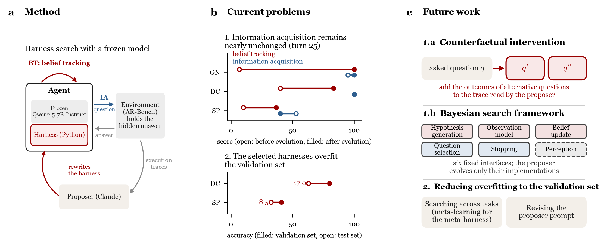
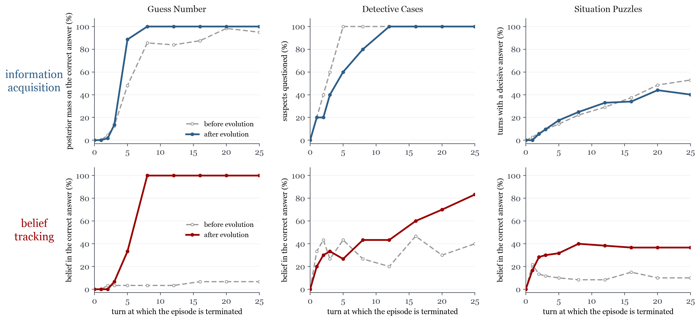
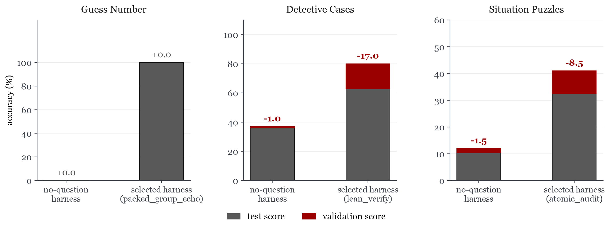

# Meta-Harness for Multi-Turn Active Reasoning

**Zining Liu** (ziningl@mit.edu) · **Yangzi Sun** (sunyz@mit.edu) — Massachusetts Institute of Technology

Active reasoning requires an agent to interact with external sources and gather missing information over multiple
turns before it can solve a problem. It involves two abilities:

- **information acquisition (IA):** selecting questions that reduce uncertainty about the answer;
- **belief tracking (BT):** updating the agent's belief from the responses.

Existing methods train these abilities into the model weights with reinforcement learning. We ask whether they can
instead be acquired without weight updates, through **harness search**. In harness search, a proposer model reads
execution traces and rewrites the code around a frozen model.

We freeze Qwen2.5-7B-Instruct and apply [Meta-Harness](https://arxiv.org/abs/2603.28052) to the three AR-Bench tasks:
Guess Number (GN), Detective Cases (DC) and Situation Puzzles (SP).



## Findings

1. **Main finding: the two abilities improve differently.** At turn 25, belief tracking improves by 26.7 to 93.3
   points across the three tasks, whereas information acquisition remains nearly unchanged.
2. **Hypothesized explanation: the counterfactual credit-assignment problem.** Belief-tracking errors are visible in
   the execution trace. The quality of a question, however, depends on alternative questions that were not asked,
   and those are absent from the trace.
3. **Secondary finding: overfitting to the validation set.** From the validation set to the test set, the selected
   harnesses lose 17.0 points on DC and 8.5 on SP.

## Setup

| | |
|---|---|
| Tasks | AR-Bench Guess Number, Detective Cases and Situation Puzzles, with a 25-turn budget |
| Splits | search 50, validation 100 and test 100 episodes per task |
| Reasoner | Qwen2.5-7B-Instruct, frozen, bf16, served with vLLM (`max-model-len` 16384, `max-num-seqs` 48), 16 concurrent episodes on one H100 80GB |
| Proposer | Claude Opus 5.5 at maximum effort; each task runs five iterations of three candidates |
| Environment | Structured responses (the SP referee's Yes / No / Unknown and the final-answer judgment) come from `jev-1.14.0`. The free-form suspect testimony on DC comes from the locally served Qwen2.5-7B-Instruct. |
| Metrics | accuracy and input + output tokens per episode on 100 episodes per cell; IA and BT per turn on 30 episodes |

**How the two abilities are measured.**

- **Belief tracking at turn *t*:** stop the episode at turn *t*, ask the system for its answer, and score that
  answer.
- **Information acquisition:** the information about the hidden answer contained in the questions and answers so
  far, independently of how the system uses it.
  - On GN it is exact: the probability of the correct number among the numbers consistent with the feedback.
  - On DC and SP the possible answers cannot be enumerated, so, following T³, we use proxies read from the
    transcript: on DC, the percentage of the five suspects questioned; on SP, the percentage of turns answered Yes or
    No rather than Unknown.

## Results

Test set, 100 episodes per cell. All baselines are re-run under our setup.

| Method | GN acc. | GN tok/ep | DC acc. | DC tok/ep | SP acc. | SP tok/ep |
|---|---:|---:|---:|---:|---:|---:|
| Zero-shot | 0.0 | 31,094 | 33.0 | 143,614 | 7.0 | 37,568 |
| Few-shot | 0.0 | 42,378 | 32.0 | 268,291 | 3.5 | 52,450 |
| Few-shot with instruction | 1.0 | 54,925 | 39.0 | 286,701 | 5.5 | 54,713 |
| Proactive CoT | 2.0 | 45,509 | 27.0 | 160,959 | 0.0 | 45,997 |
| Tree of Thoughts | 6.0 | 21,196 | 34.0 | 244,318 | 9.0 | 11,360 |
| Ask nothing (anchor) | 0.0 | 226 | 36.0 | **847** | 10.5 | **215** |
| **Ours**, cost-efficient | **100.0** | **7** | 57.0 | 18,308 | 31.5 | 10,913 |
| **Ours**, best | **100.0** | **7** | **63.0** | 25,715 | **32.5** | 16,142 |

**Information acquisition and belief tracking at turn 25** (before → after evolution, *n* = 30):

| | GN | DC | SP |
|---|---|---|---|
| Belief tracking | 6.7 → 100.0 | 40.0 → 83.3 | 10.0 → 36.7 |
| Information acquisition | 95.0 → 100.0 | 100.0 → 100.0 | 52.9 → 40.1 |



The modules responsible for the gains all operate on the belief:

- `verified_menu` (GN) maintains the consistent candidate set outside the model;
- `prior_verify_stop` (DC) stops once sufficient evidence has been collected;
- `certify_switch` (SP) accepts a claim only after two differently worded questions both receive Yes.

GN is the one exception on the question side. Its observation model is a deterministic function, so the search
produced a module that scores guesses by how many candidates each would leave.

**Overfitting.** The selected harnesses lose 17.0 points on DC and 8.5 on SP from the validation set to the test
set. The harness that asks no questions loses at most 1.5, and GN shows no gap.



## Next steps

1. **Counterfactual intervention.** At each question point, send *K* alternative questions to the real environment
   and write their answers into the trace read by the proposer. Nothing else changes. If information acquisition
   still does not improve, the hypothesis is rejected.
2. **A Bayesian skeleton.** If step 1 fails, fix the factors of the Bayesian agent as interfaces and let the proposer
   evolve only their implementations:
   - hypothesis generation;
   - observation model;
   - belief update;
   - question selection by expected information gain;
   - stopping.
3. **Reducing overfitting.**
   - Compare proposer prompts with and without task-specific guidance.
   - Search across all three tasks at once.
   - Test on active-reasoning tasks that were not used in the search.

## Code

| path | content |
|---|---|
| [`meta/arbench_mh/`](meta/arbench_mh/) | the three AR-Bench tasks for Meta-Harness: `gn/`, `dc/`, `sp/` (environment, harness base class, seed harnesses, and the evolved GN harnesses), and `mh_benchmark.py`, the benchmark entry point that Meta-Harness's loop calls |
| [`meta/tools/`](meta/tools/) | scoring (`score_val.py`, `score_test_grid.py`), the per-turn IA/BT measurement (`ia_bt.py`) and the figure scripts |
| [`notes/arbench_mh/`](notes/arbench_mh/) | run log, main-table source, IA/BT curves, published baselines and the domain specification given to the proposer |
| [`figures/paper/`](figures/paper/) | the figures of the report |
| `meta_harness_official/` | the pinned Meta-Harness repository (submodule; see [`THIRD_PARTY.md`](THIRD_PARTY.md)) |

```bash
cd meta/arbench_mh
python mh_benchmark.py --task dc --memory baseline_tot                    # score one harness
python mh_benchmark.py --task dc --frontier --model Qwen2.5-7B-Instruct   # accuracy-cost frontier
python mh_benchmark.py --task dc --results
```

## Earlier experiments

Before this report, we ran test-time harness evolution with a label-free judge on Circuit Decoding (Multi-Turn
Puzzles) and Situation Puzzles, together with an audit of SP's character-level F1. These experiments are not part of
the report. They are logged in [`notes/EXPERIMENTS_LOG.md`](notes/EXPERIMENTS_LOG.md) and [`experiments/`](experiments/).
