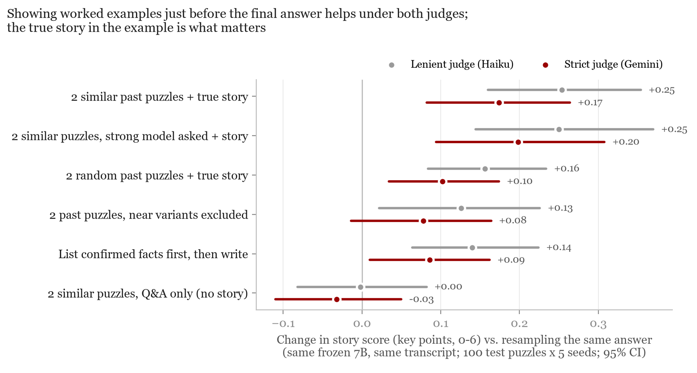
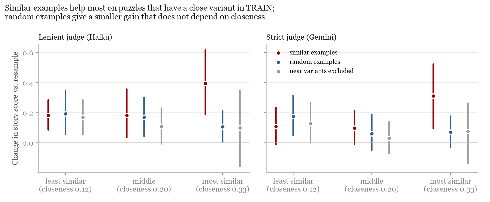
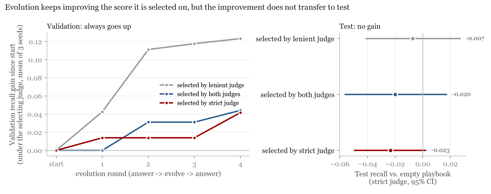
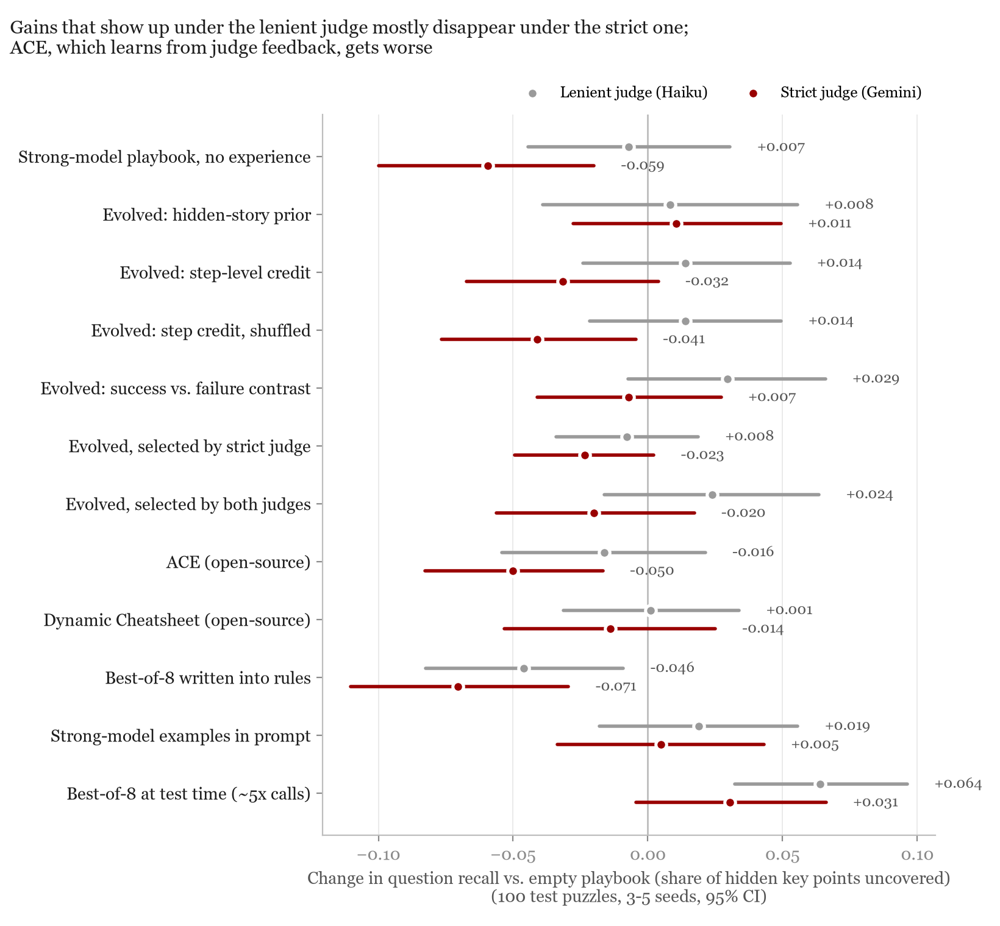
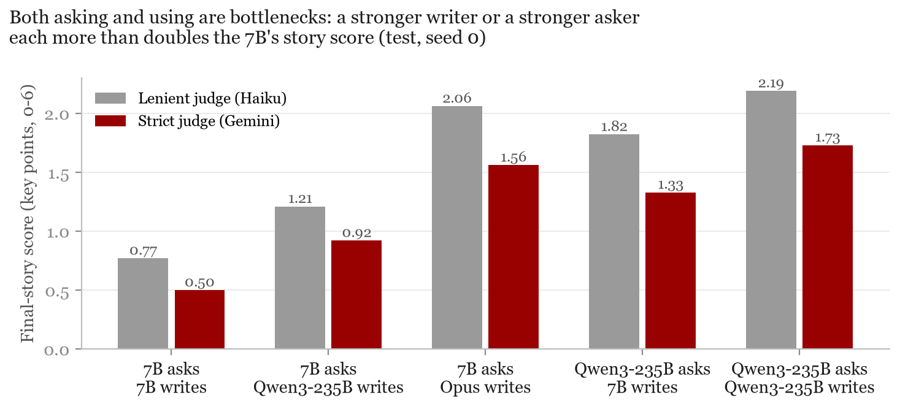

# 13 — Context evolution on Situation Puzzles (2026-11-07–11-08)

Yangzi Sun's part of the project. Same setting as the harness experiments: Qwen2.5-7B-Instruct stays frozen. The difference is
what we let change. Here only the text the model reads changes: a playbook of rules while it asks questions, or a memory
of past puzzles and their true stories right before it answers.

All numbers are on the 100 official SP test puzzles, 3 to 5 seeds, paired by puzzle, with 95% bootstrap confidence
intervals. Full tables are in [RESULTS.md](RESULTS.md).

## Short version

1. **Evolving the questioning playbook does not hold up on test.** Validation recall ends higher in every run, because we
   only keep a new playbook when it goes up. On test, under a strict judge, no evolved playbook beats the empty one. ACE and Dynamic Cheatsheet do
   not help either.
2. **Part of the "gain" was the judge.** Our first judge (Haiku) was lenient. Small gains under it disappear under a
   stricter judge (Gemini). ACE, which learns from judge feedback, gets significantly worse.
3. **The 7B loses many points when it uses what it found, not only when it asks.** From the 7B's own questions, a
   stronger model writes a story that scores three times as high under the strict judge (1.56 vs. 0.50).
4. **What works: a memory of past puzzles at the answer step.** Right before the final answer, the 7B sees two training
   puzzles it played before: its own questions and answers, plus the true story. Same model, same transcript. Story
   score goes from 0.49 to 0.67 under the strict judge (+0.17, CI [+0.08, +0.26]); +0.25 under the lenient one. Without the true stories there is no gain.
   Random past puzzles still help (+0.10 strict), so it is not only about finding a near copy of the test puzzle.

## Figures

**Answer-step memory (main positive result)**

**Where the gain comes from.** Test puzzles sorted by how close their story is to the nearest training story. SP has
near variants of the same puzzle across train and test, and similar examples help most there. Random examples help a bit
everywhere.

**Evolution rounds: validation vs. test**

**Lenient vs. strict judge, all questioning methods**

**Asking vs. using**

## Setup

The protocol differs from [07](../07_sp_bare_405judge/README.md) and [10](../10_sp_tthe_pilot/README.md) in two ways.
The referee is Qwen3-235B-A22B instead of the 405B, because these runs went through an API. And the task score is the
number of key points the story gets right (AR-Bench's grading prompt), not character-level F1, because F1 mostly tracks
answer length (see A4 in the log). Numbers here are therefore not comparable with 07 and 10.

| | |
|---|---|
| Agent | Qwen2.5-7B-Instruct (frozen), up to 25 questions, then a final story |
| Referee | Qwen3-235B-A22B, answers Yes / No / Unknown from the hidden story |
| Data | official SP train split into 300 TRAIN / 100 VAL; official 100 test puzzles for all reported numbers |
| Question recall | share of the hidden story's key points that the questions uncover (information acquisition) |
| Story score | key points (0 to 6) the final story gets right, AR-Bench grading prompt (task score) |
| Judges | Claude Haiku 5.5 (lenient) and Gemini 3.7 Flash (strict); checked against Claude Opus 5.5 on 100 items |
| Cost | 51 calls per episode (25 questions, 25 referee answers, 1 final answer) |

## Methods tried

| Name in code | What it does |
|---|---|
| `a0` | empty playbook |
| `traj` | evolve rules from successful vs. failed episodes, 4 rounds, keep a new playbook only if VAL improves |
| `cce`, `cce_shuf` | evolve rules from step-level credit (ask 8 alternative questions at the same state); `cce_shuf` shuffles the credit as a control |
| `prior` | evolve a prior over common hidden stories |
| `traj_gem`, `traj_cons` | same as `traj`, but selected by the strict judge, or by both judges |
| `ace`, `dc` | ACE and Dynamic Cheatsheet, adapted to SP |
| `r1` | best-of-8 at test time (about 5x the calls) |
| `bo8` | best-of-8 choices written into rules |
| `balar` | BALAR, Bayesian question selection (1 seed, about 297 calls per episode) |
| `ex7b` | answer-step memory: 2 similar TRAIN puzzles (the 7B's own past questions and answers) + true story |
| `ex7b_rand`, `ex7b_far`, `ex7b_nostory` | controls: random examples, near variants removed, no true story |
| `tex7b` | answer-step memory with episodes from a stronger asker (Qwen3-235B) |
| `plain7b` | control: resample the final answer from the same transcript, no examples |

## Limitations

- All grading is by LLM judges, no human labels. We report a result only if it holds under the stricter judge.
- The absolute gain is small (under 0.3 of 6 key points).
- SP only so far.
- Part of the gain from similar examples comes from near-variant puzzles in the benchmark. The random-example number is
  the conservative estimate.

## Reproduce

`code/` has the scripts. Calls go through OpenRouter; set `OPENROUTER_API_KEY`. Main entry points:
`evolve.py` (playbook evolution), `evaluate.py` (test episodes), `rescore_test.py` and `story_test.py` (strict judge),
`use_step.py` (answer-step memory and controls), `make_figures_final.py` (figures).
