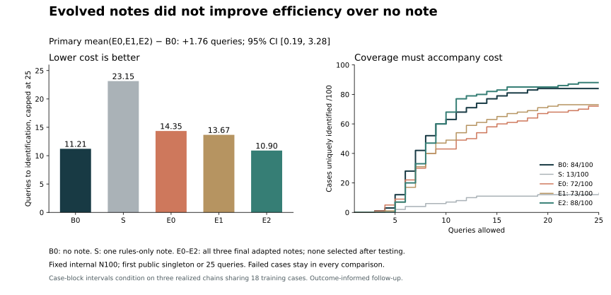

# GN: can text-memory evolution reduce question cost?

**The tested adaptation package did not improve question efficiency over the no-note baseline.** Across three realized learning chains and 100 paired internal evaluation cases, adapted notes needed **1.76 more queries** on average (paired case-block bootstrap 95% CI **[0.19, 3.28]**). Identification coverage also fell on average. One chain was slightly better descriptively, with an interval spanning both benefit and harm; it is not selected or reported as a successful method.

This is a new prospective follow-up to the [readout studies](../sun_gn_readout/README.md). Those studies showed that external constraint computation can supply a final answer. This experiment instead tests the **questions generated before readout**. The actor never receives candidate lists, counts, recommended guesses, or the monitor's state. No final model-answer call is made. The exact public-feedback monitor is shared across every arm.

## Fixed design

- Frozen Qwen2.5-7B-Instruct revision `a09a35458c702b33eeacc393d103063234e8bc28`; temperature 0.7, top_p 0.7. Actor cap128 output tokens; curator cap512. No weight training.
- Eighteen training cases and 100 evaluation cases were fixed before model requests from an eligible internal pool of1,801, excluding the declared earlier datasets and exposed values. This restricted, train-derived sample is not an official-test replication or a claim of pretraining-unseen data. Exclusions never prune the monitor's full5,040-secret universe.
- Three learning chains start with an **empty note**, exactly the no-note prompt. Each makes six updates after batches of three training episodes, using independently fixed orders and seeds over the same18 cases. They are not three independent training datasets.
- The curator sees previous notes and training-only public guesses/feedback, candidate-count reductions and capped costs. It sees no hidden labels or held-out outcomes. Numerical strategies and opening sequences are allowed. Mechanical format failures retain the prior bytes; there is no repair, retry or best-checkpoint selection.
- S is one rules/objective-only note generated before training by the same curator. It is a separate comparator, **not the chains' starting note**, and does not match the extra rewrite compute. All three final E notes are evaluated, even if unchanged.
- Each of100 new cases is evaluated under B0, S, E0, E1 and E2. Arm order rotates. Same case/slot seeds do not guarantee matched stochastic behavior across different prompts.
- Stop at the first public singleton or25 queries. Malformed queries consume a slot. Unresolved cases remain in the primary endpoint with capped cost25. No sample shrink, performance-based restart, or repeated request.

The protocol and curator prompt are in [protocol.json](protocol.json). The experimental protocol's pre-run SHA256 was `51552ae47d234f431bad1c8855a2d7eaa83b4004eb0874e451180dcc8225b877`; the public copy omits private execution controls. This was frozen before requests, not externally preregistered before the earlier outcome-informed design decisions.

## All arms, all cases

| Arm | Mean queries, capped25 ↓ | Identified by5 | by10 | by15 | by25 |
|---|---:|---:|---:|---:|---:|
| B0: no note |11.21|12|63|79|84|
| S: one rules-only note |23.15|2|7|11|13|
| E0: final chain0 |14.35|9|43|60|72|
| E1: final chain1 |13.67|7|49|65|73|
| E2: final chain2 |10.90|7|68|83|88|

Every coverage count has denominator100. Average E cost is12.9733, versus B0's11.21; average E identification is77.67%, versus84%. The latter averages three outcomes per case, not300 independent cases.

The prespecified primary contrast is the case-average of mean(E0,E1,E2) minus B0: **+1.7633** queries, 95% CI **[+0.1933,+3.2767]**,33 paired wins/66 losses/1 tie. Lower is better. The prespecified two-query practical benefit is excluded by this conditional interval. Assigning unresolved cases a penalty26 instead gives+1.8267 [0.1733,3.4134]; this is a sensitivity endpoint, not an estimate of their unobserved completion times.

Secondary chain contrasts E−B0 are E0:+3.14 [1.25,5.04], E1:+2.46 [0.42,4.45], E2:−0.31 [−2.10,1.47]. They are descriptive, without multiplicity-adjusted claims. E2's observed advantage does not demonstrate reliable improvement, and its88/100 identification is not proof of general superiority.

Mean E−S is−10.1767 [−11.5767,−8.7233] queries. This is a large improvement over a particularly poor **single static draw**, not evidence of improvement over the initial policy. Reporting only that comparison would hide the primary failure.



## What changed, and what did not

Accepted note changes were3/6,5/6 and5/6 for E0–E2. The observed deterioration is therefore not explained by a completely unchanged memory. All 7,328 evaluation queries produced a guess under the original parser, and none were length-truncated. **Parsing success does not mean strict four-digit format compliance:** 38 raw outputs contained overlong numerals (37 five-digit and one six-digit), all in S's three affected, unresolved episodes. The unchanged parser extracted their first four digits; 36 of these queries did not reduce the candidate set. None occurred in B0 or E0–E2, so this artifact does not affect the primary E-versus-B0 comparison. The public protocol documents the extraction rule.

Mean realized information reduction per valid query was1.0775 bits for B0,0.3432 for S,0.8114 for E0,0.8655 for E1 and1.1125 for E2. These are descriptive rates across different states and stopping times, not a causal decomposition.

Additional [aggregate mechanism summaries](mechanism-summary.json) are explicitly posthoc. By the third query, all ten digits had been covered in 25 B0 cases, 2 E0 cases, 17 E1 cases, 100 E2 cases, and no S cases; all cases were still observed through that query. Zero-candidate-reduction rates were 40.9%, 54.8%, 51.0%, 36.6%, and 75.8%, respectively. Most such queries were new guesses rather than exact repetitions. E2 used the same four-query opening in 94 cases, but its next queries did not consistently follow the note's feedback conditions. These observations do not establish full instruction compliance, a causal mechanism, or a successful E2 method. Early stopping changes later-query denominators.

The final notes range from generic information-gain/diversification advice to explicit feedback-conditioned numerical sequences. The study does not isolate whether numerical content, instruction length, training feedback, or stochastic prompt effects produced the differences. It also lacks a compute-matched no-feedback rewrite chain. A benefit over S would not, by itself, isolate the value of learning from experience.

**Project implication:** text edits that sound strategic need not yield better actions. Under this tested procedure, adding learned notes costs more questions and lowers average coverage than leaving the prompt alone. This is evidence against this configuration, not proof that all self-evolution is ineffective. The successful answer-supplied readout remains a separate engineering result.

## Verification and resources

The run completed54 training and500 evaluation episodes, with7,986 actor and19 curator requests:8,005 total,8,289,665 input tokens and66,755 output tokens. It used434 GPU seconds on one L40S; experimental API charges were$0. The primary per-episode metric does not include the extra658 training actor requests or19 curator requests; total costs are reported separately.

One post-run CPU audit passed in18.597 seconds. Separate reconstruction code checked all requests and responses, original parser/feedback, complete coverage, memory lineage, temporal separation, exact prompt/sampling parameters, budget bindings and statistics. The same assistant operated execution and audit; Research/Claude review reported evidence rather than independently reproducing the private run. Audit SHA256:`1c971180de1b5926109ca935d87aceeafc393ac02fddd3d0e90d8046de9451e5`. Journal SHA256:`7afb1acc3172509a41b8f00bc3276c91aaf4cb44ef776f5c52f699febd3d9c19`.

The public `question_policy.py` is byte-identical to the run's public-feedback monitor/note interface. Exact solving is already implemented elsewhere in this repository and is not claimed as novel. The full private serving/deployment harness is not included. `anonymous-cases.json` contains all100 paired outcome rows, without original IDs, target labels, guesses, transcripts, credentials or cluster paths.

From this directory, with standard-library Python:

```sh
python -B -m unittest discover -v
python -B verify_results.py anonymous-cases.json
```

The verifier recomputes every released contrast and resolution curve from anonymous rows using10,000 paired case-block resamples and seed62026. It verifies arithmetic and pairing, **not raw execution provenance**. Optional figure regeneration requires matplotlib: `python plot_results.py`.

Confidence intervals condition on these three realized chains sharing18 cases. They do not quantify variability over training datasets, models or tasks. This is sequential, outcome-informed method development on an internal distribution. Fresh held-out cases do not erase those choices or provide family-wide error control. Both the negative primary result and all secondary outcomes are retained.
