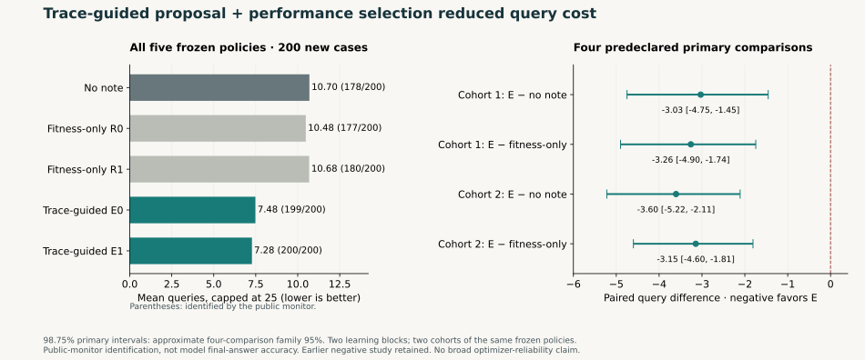

# Selected text policies: trace guidance versus fitness-only rewriting

**The predeclared repeated-benefit and added trace-value criteria were met within this study.**

This is tool-supervised text-policy selection, with no weight training.
The model is Qwen2.5-7B-Instruct at frozen revision
`a09a35458c702b33eeacc393d103063234e8bc28`, temperature/top_p 0.7/0.7.
Actor and curator output caps are 128 and 512 tokens; notes have an 800-byte cap.
Two learning blocks each pair a trace-guided E search with a fitness-only R
search. Every search starts with an empty note and has six proposal opportunities.
E receives its own three public training traces per round; R receives no traces.
Both use the same 48-case selection bank within their block and the same gate:
at least one fewer mean capped query, with no reduction in identification count.
The incumbent vector is cached. Invalid, KEEP and byte-identical proposals get
no replacement. R also has access to performance-based selection, but neither
realized R search promoted a proposal. E-R compares the trace-guided search
package under this procedure; it does not isolate trace content from extra
training interactions and proposer-input cost, or all experience versus none.
Proposal opportunities and selection
caps are matched; total training compute and input tokens are not.

All four final policies and the empty-note B0 are evaluated on the same 200
cases, in two new 100-case cohorts, after all policies are frozen. Each episode
stops at the first singleton of an exact public-feedback monitor, or 25 queries.
Unresolved episodes remain at capped cost 25; resolution at turn 25 is distinct
from nonresolution. The actor receives ordinary feedback and its note, without
candidate lists, counts or recommended queries. No final model-answer call is
made; monitor identification measures information sufficiency, not internal
beliefs or demonstrated final-answer ability. Parser recognition does not imply
strict raw-output format compliance or complete instruction following.

All 200 cases and all five arms are retained in [anonymous-cases.json](anonymous-cases.json). The machine-readable summaries and frozen audit statistics are in [results.json](results.json); [PUBLIC-SCHEMA.json](PUBLIC-SCHEMA.json) specifies ordering and resampling.

| Cohort | Primary contrast | Mean difference | 98.75% primary interval |
|---|---|---:|---:|
| 0 | Emean-B0 | -3.0300 | [-4.7500, -1.4550] |
| 0 | Emean-Rmean | -3.2600 | [-4.9000, -1.7450] |
| 1 | Emean-B0 | -3.6050 | [-5.2200, -2.1100] |
| 1 | Emean-Rmean | -3.1450 | [-4.6000, -1.8100] |

Negative differences favor E. Each primary contrast uses 100 paired cases. Each cohort has its own 20,000 case-block bootstrap draws (seeds 63026 and 63027).

| Sample | Arm | Mean capped queries | Identified / N |
|---|---|---:|---:|
| 0 | B0 | 10.5100 | 88/100 |
| 0 | E0 | 7.6200 | 99/100 |
| 0 | R0 | 10.4700 | 87/100 |
| 0 | E1 | 7.3400 | 100/100 |
| 0 | R1 | 11.0100 | 88/100 |
| 1 | B0 | 10.8800 | 90/100 |
| 1 | E0 | 7.3400 | 100/100 |
| 1 | R0 | 10.4900 | 90/100 |
| 1 | E1 | 7.2100 | 100/100 |
| 1 | R1 | 10.3500 | 92/100 |
| pooled | B0 | 10.6950 | 178/200 |
| pooled | E0 | 7.4800 | 199/200 |
| pooled | R0 | 10.4800 | 177/200 |
| pooled | E1 | 7.2750 | 200/200 |
| pooled | R1 | 10.6800 | 180/200 |

| Pooled contrast | Mean difference | 95% descriptive interval |
|---|---:|---:|
| E0-B0 | -3.2150 | [-4.1550, -2.3100] |
| R0-B0 | -0.2150 | [-0.7050, +0.2550] |
| E1-B0 | -3.4200 | [-4.3200, -2.5550] |
| R1-B0 | -0.0150 | [-0.6450, +0.5900] |
| Emean-B0 | -3.3175 | [-4.2150, -2.4575] |
| Emean-Rmean | -3.2025 | [-4.0450, -2.3950] |

Pooled intervals use 20,000 stratified paired-case resamples, preserving 100 cases per cohort (seed 63028). Per-cohort individual-run 95% intervals are also retained in results.json.

| Predeclared repeated-benefit criterion | Met |
|---|---|
| both_cohort_Emean_B0_primary_upper_below_zero | true |
| each_E_run_negative_point_in_each_cohort | true |
| each_cohort_observed_mean_gain_at_least_two | true |
| each_E_pooled_coverage_not_below_B0 | true |

An observed point reduction of two queries, if present, does not establish an effect of at least two queries.

| Search | Proposals | Invalid | KEEP | Identical | Evaluated | Replacements |
|---|---:|---:|---:|---:|---:|---:|
| E0 | 6 | 2 | 0 | 0 | 4 | 1 |
| R0 | 6 | 0 | 0 | 0 | 6 | 0 |
| E1 | 6 | 0 | 0 | 3 | 3 | 2 |
| R1 | 6 | 0 | 0 | 0 | 6 | 0 |

Mechanical acceptance includes KEEP; an accepted replacement requires a measured selection improvement. Candidate-selection and training work are reported separately from evaluation query cost in results.json.

Intervals condition on only two realized E/R learning blocks. The two
cohorts evaluate the same frozen policies; they are not additional learning
runs. The four primary 98.75% percentile intervals use approximate Bonferroni
family coverage of 95% for this study's four contrasts, not the full history of
sequential, outcome-informed research. Fresh held-out cases do not erase earlier
design choices. All individual-run and pooled 95% intervals are descriptive.
The pooled coverage criterion does not guarantee coverage within each cohort;
both are reported. Selection promotions alone do not establish held-out benefit.
This restricted internal task/model study does not establish broad self-evolution
or generalization across tasks, models or training distributions. Public rows
support arithmetic checks; they do not independently reproduce private execution
provenance. Audit PASS validates execution/replay, not a positive research result.

Source audit SHA256: `f14aeabf903bd920b76c9d27b490beb3ebfbc5b4924485a9c661ff2aa10e6b78`. The builder copies the audit intervals and verifies their endpoint means and declared flags against released rows; it does not rerun the bootstrap or execution audit.

## What changed, and what this contributes

The earlier [three-chain question-efficiency experiment](../sun_gn_question_efficiency/README.md)
was negative: adapted notes averaged **1.76 more queries** than no note
(95% interval 0.19 to 3.28). All three chains remain reported. The present
procedure was frozen before its new held-out evaluation; it is not an external
preregistration. It adds measured proposal selection and changes the scientific
procedure. The cross-study comparison does **not** identify selection alone as
the cause of the improvement.

In this study, the two trace-guided, performance-selected policies averaged
**7.3775 versus 10.695 queries** on 200 new cases: 3.3175 fewer, or **31.02% less
held-out capped query cost**. Both learned policies improved in both cohorts.
This is a useful, bounded demonstration of text-policy improvement. It is not
a claim of 31% total compute savings, weight learning, or a generally reliable
optimizer.

## What the learned policies do

[learned-policies.json](learned-policies.json) exports the exact final strategy
artifacts. E0 and E1 are seven- and nine-query lists, with no conditional rules
in the note. The observed behavior mainly supports **useful fixed query
schedules**, not broad learned adaptive reasoning. For example, repeat queries
fell from 145/2139 in B0 to 8/1496 in E0 and 0/1455 in E1; queries without
candidate-set reduction fell from 781/2139 to 194/1496 and 139/1455.
These rates are exploratory and affected by early stopping. E was not ahead
at every early turn. [MECHANISM.txt](MECHANISM.txt) and
[mechanism-summary.json](mechanism-summary.json) retain the qualifications,
including outcome-selection bias in shared-success comparisons. No new causal
mechanism ablation was performed.

A separate, post-hoc **exact enumeration of all 5,040 legal hypothetical
secrets** characterizes the schedules without using private cases or a model.
If executed faithfully, E0's seven queries uniquely identify 2,729/5,040
(54.15%); E1's nine queries identify 4,583/5,040 (90.93%). At the same seven-query
prefix, E1 identifies 3,199/5,040. Unresolved hypotheses require additional
questions whose costs are not inferred. The complete prefix partitions and
small independent correctness checks are in
[public-schedule-partitions.json](public-schedule-partitions.json), generated by
[public_schedule_analysis.py](public_schedule_analysis.py). These are exact
properties of the selected lists, not another learning replicate, an actor
adherence guarantee, a globally optimal strategy, or the private sample's
empirical success rates.

Neither R search promoted a proposal; R0/R1 finished with empty notes like B0.
They are separate rollouts, not deterministic replicas. All 200 first requests
and first texts matched for each empty-policy pair. Later first text differences
occurred on 69, 74 and 80 cases for B0-R0, B0-R1 and R0-R1, respectively, even
though the recorded request objects and seeds still matched at those points.
The underlying runtime cause was not isolated, statistical independence was
not established, and original HTTP byte streams were not captured. E-R compares
the realized search packages; it does not show
an advantage over a successfully learned R policy or a compute-matched control.

## Reproduce and inspect

- [REPRODUCE.md](REPRODUCE.md): exact public statistical replay and a separately
  labelled, fresh-data method replication route.
- [code/](code/): frozen prompts, selection rule, portable search, public example
  environment and focused synthetic checks. Supply a matching model adapter;
  the example does not reproduce the restricted internal dataset or execution.
- [verify_results.py](verify_results.py) and [verification-result.json](verification-result.json):
  independent public-row implementation reproduced all 44 interval endpoints,
  all arm counts and declared flags exactly in one completed check.
- [learning-lineage.json](learning-lineage.json): all 24 opportunities, rejections,
  cached-incumbent comparisons and promotions. E0 promoted proposal 2; E1
  promoted 1 and 2; R promoted none.
- [COSTS.md](COSTS.md) and [descriptive-costs.json](descriptive-costs.json):
  actual search/evaluation costs and explicit amortization assumptions.

The selected-policy study used 784 GPU seconds and 21,334 requests, including
11,988 learning actor requests and 24 curator requests. Full project history,
including failures, totals **7,660 conservative GPU seconds** against a
14,400-second cap; experiment API spending is $0. Search costs do not disappear
because subsequent inference is cheaper. The paired bootstrap conditions on
the two policies learned here and does not capture optimizer-run variability.

The separate execution audit and the public statistical verifier passed, but
both were conducted within the same execution team. Research and Claude reviewed
reported evidence and interpretation; neither independently reran the raw study.
