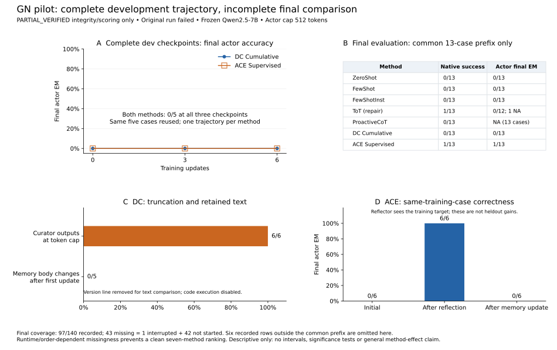

# GN pilot: verified partial evidence, failed full comparison

The complete development trajectory is available: DC and ACE each score **0/5 final actor exact match at updates 0, 3 and 6**. Each method has one learning trajectory, and the same five cases are reused. These are not 15 independent trials per method.

The original run failed at its request-admission boundary. Of 140 planned final-evaluation slots, 97 were recorded and **43 are missing: one interrupted episode and 42 not started**. The interruption contains 29 completed calls; its next request was never issued. Runtime/order-dependent missingness prevents a clean ranking of seven methods.

`PARTIAL_VERIFIED` means available artifacts and captured native scoring passed separate partial forensic checks (74,187 checks, zero reported issues). It does not mean the full comparison passed, establish scientific success, or constitute external replication. Separate partial verification was performed within the same execution team. Full strict auditing was not run; upstream DC/ACE memory-merge logic was not independently reimplemented. [Integrity scope](integrity-summary.json) binds the original partial report without exposing private paths.

The exported final comparison uses the **original first 13 cases**, completed by all seven methods: 91 paired rows. Six additional complete rows from case 14 are omitted from this common-prefix display, not erased from the coverage count. This is a posthoc incomplete-prefix description, not the planned 20-case comparison. No confidence intervals, significance tests or missing-as-zero scores are supplied.

Native success and explicit final actor exact match remain separate. The ToT success in this prefix has no assessed final actor answer. ProactiveCoT final actor exact match is unassessed under its native output structure; `null` means unassessed, never failure. On dev, ACE at update 0 hit the answer once during questioning but produced a wrong final answer. These diagnostics must not be conflated with the earlier public-feedback singleton monitor, which was a different endpoint.

The update diagnostics are descriptive extraction from saved records, not independent replay of the upstream update algorithms. They do not isolate the cause of stagnation or show that merging caused a loss of correctness:

- DC: all six curator outputs reached the 1,024-token cap. Updates 2–6 changed only the Version line. After removing that line, there are zero body changes in five transitions. Generated code execution was disabled.
- ACE: on each of six training cases, the initial answer was wrong, the answer after target-informed reflection was correct, and the answer after memory updating was wrong again. The reflector saw the training target. These are dependent stages on supervised training cases, not heldout gains.

This is a compute-controlled Qwen2.5-7B native-algorithm/task-adapted-memory pilot with a 512-token actor cap. It is not a full paper/CLI reproduction; native UoT, SFT and DPO were not run. The observations do not identify why either original method succeeds or fails generally. [Protocol summary](protocol-summary.json) records the caps and supervision difference.

## Files and exact arithmetic replay

From this directory, run `python -B verify_results.py`. This standard-library script validates the anonymous matrix and recomputes [results.json](results.json) from [anonymous-numerics.json](anonymous-numerics.json). It checks arithmetic, not private execution provenance. [tables.csv](tables.csv) is the same descriptive table in spreadsheet form. With matplotlib already installed, `python -B plot_results.py` regenerates PNG and SVG figures; neither script calls a model or network service.

The row convention is fixed: `D01`–`D05` identify the reused development cases in original protocol order; `F01`–`F13` identify the common final prefix in original protocol order. Each row contains only split, checkpoint, arm, anonymous case alias and three boolean/null metrics. Update rows contain only step numbers, numeric call facts and boolean diagnostics. `native_success` follows the native harness; `actor_final_em` scores an identifiable final actor answer; `hit_at_any` records any correct logged guess, including a final guess where present. No targets, source case IDs, prompts, trajectories, learned text or per-target hashes are included.

Whole-artifact SHA-256 bindings reference the frozen original protocol, original result, allocation receipt and partial forensic report/code. Those bindings do not make private artifacts available for independent public reconstruction. Exact numerical replay is possible from this package; exact model-run reproduction is not.
