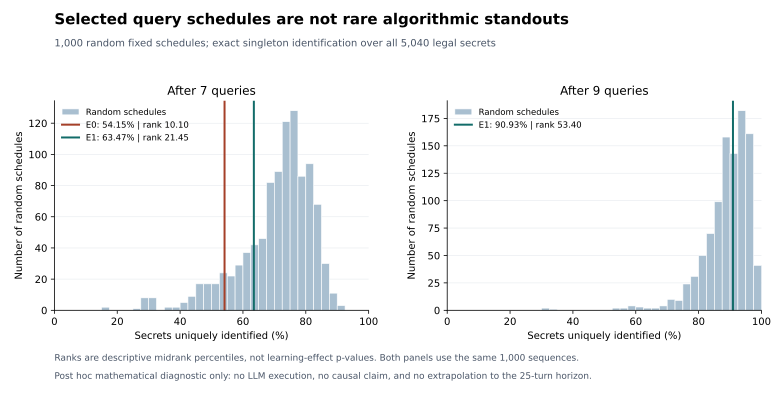

# Fixed-sequence random reference

This post hoc algorithmic diagnostic asks whether the exact query schedules extracted from E0 and E1 are unusually effective at distinguishing four-digit secrets. They are not exceptional within this reference distribution. This motivates matched **LLM-executed random and static controls**; it does not establish that self-evolution is useless.

| Schedule | Queries used | Uniquely identified / 5,040 | Identification | Descriptive midrank percentile |
|---|---:|---:|---:|---:|
| E0 | 7 | 2,729 | 54.15% | 10.10 |
| E1 | 7 | 3,199 | 63.47% | 21.45 |
| E1 | 9 | 4,583 | 90.93% | 53.40 |



## What was compared

The public universe contains all 5,040 ordered four-distinct-digit strings, including leading zero, with equal weights. Each control is a uniformly sampled ordered list of nine distinct legal guesses. Python `random.Random(20261026).sample(range(5040), 9)` was called 1,000 times in order, using the lexicographic permutation universe. Whole sequences were not rejected for duplication. The seven- and nine-query results share each sequence; they are **not 2,000 independent samples**.

After a fixed prefix, secrets are grouped by their full vectors of positional matches (bulls) and shared digits in other positions (cows). The endpoint counts secrets in singleton groups. It assumes faithful execution of the fixed guesses. It is not final actor exact match, question cost to a 25-turn horizon, or a measure of model understanding.

The schedules are published as guesses only; no learned prose or private case records are needed:

- E0: `1234 5678 9012 3490 6789 4390 2879`
- E1: `1234 5678 9012 3456 7890 1357 2468 0379 1478`

Percentile is `100 × (strictly below + 0.5 × equal) / 1000`; higher identification is better. E1 at seven queries has one tie, and E1 at nine has two. Full below/equal/above counts, nearest-rank quantiles, means and population standard deviations are in `result.json`. No inferential test or additional statistic was introduced for this appendix.

## Interpretation and limits

This analysis was designed after observing the selected schedules and their outcomes. The sequence reference does not model the adaptive search/selection process and is **not a learning-effect p-value**. It provides no evidence about whether an LLM follows a schedule, the quality of its feedback interpretation, or the causal contribution of training. The earlier reported approximately 31% benefit remains an estimate from its original experiment: this diagnostic neither retracts that estimate nor identifies its cause. It does not justify extrapolation to self-evolution in general.

The universe here is mathematical, not the historical evaluation sample. No private labels, dataset row IDs, teammate conversations, credentials or upstream source/prompt text are included. A matched LLM control experiment would require its own protocol and authorization; nothing in this appendix starts or authorizes one.

## Files and verification

- `random-sequences.json`: all 1,000 anonymous sequences and their original exact counts; byte-identical to the original diagnostic output.
- `result.json`: the original numerical result, preserved byte-for-byte (SHA-256 `4477a2abe191d374d756411b61bd2c39b1a0f6a07b17beed1c62645e709cafe4`). Its execution and native-code validation entries describe the **prior diagnostic**, not new checks made while packaging.
- `analyze.py`: original, portable standard-library mathematical implementation. It imports no benchmark, model, private workspace or vendored code. By default it reproduces the preserved summaries from the stored counts.
- `verify.py`: checks file hashes, all row schemas, all 1,000 deterministic draws and every preserved summary; mathematically recomputes the three anchors and random rows 1 and 1,000 only.
- `distribution.svg`: two histograms of the original counts, with the selected schedules marked; no fitted distribution or new inference.
- `MANIFEST.json` and `verification.json`: content bindings and the actual packaging check record. The manifest intentionally excludes itself and the later verification report to avoid a hash cycle.

Run the small check with Python 3.11 or later, without third-party packages:

```sh
python -B verify.py
python -B analyze.py
```

`python -B analyze.py --recompute-all` optionally recomputes every mathematical partition and checks it against the preserved counts. **That full mode was not run for this appendix.** The small verifier was run once; its report distinguishes its limited checks from the earlier full diagnostic.

The prior diagnostic checked native feedback on 70,560 pairs and used digit-relabeling invariance to check all 25,401,600 table entries; those are historical provenance statements preserved in `result.json`, not claims of new native validation. The new mathematical implementation uses positional equality and distinct-digit set intersection, with no copied upstream implementation. Neither the appendix nor its verifier is a full audit of the learning experiment.
