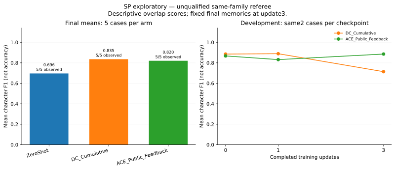

# SP descriptive results — UNQUALIFIED same-family referee

The completed exploratory run contains 33 episodes (6 training, 12 development, 15 final), six memory updates and 1,692 generation calls. Its independent mechanical audit is `PASS_WITH_LIMITS`, with 38,260 checks and zero issues. **Publication readiness remains false:** the referee has not met the required human qualification. A subsequent fixed 30-reply source review by the execution-team AI found 23 supported, one contradicted and six unresolved replies; this is not human gold or an estimated error rate. See [supplementary review](feedback-source-review.json). Mechanical completion does not establish correct referee feedback.

*Figure: five final cases per arm; two reused development cases; one learning trajectory per method; unqualified same-family referee.*

| Method | Dev character F1 at updates 0 → 1 → 3 (same 2 cases) | Final character F1 (5 cases) | Diagnostic final word F1 |
|---|---|---:|---:|
| ZeroShot | Not scheduled | 0.6962 | 0.3109 |
| DC-Cumulative | 0.8855 → 0.8890 → 0.7134 | 0.8353 | 0.3090 |
| ACE-Public-Feedback-SP | 0.8672 → 0.8313 → 0.8857 | 0.8200 | 0.3197 |

These are literal-overlap scores, not accuracy. Both learners have higher final character F1 than ZeroShot on this five-case set, while word F1 changes little. The discrepancy does not prove that the character-F1 difference is spurious, and it does not identify answer length as a cause. This does not demonstrate semantic improvement, causal superiority or a reliable method ranking. Each method has one learning trajectory; development reuses two cases. Final memory is fixed at update 3, with no best-checkpoint selection. All roles use the same model family, without a supported provider seed.

[The 15 paired final-answer length records](final-answer-lengths.json) contain no answer text. Mean characters / whitespace words / provider completion tokens are 503.2 / 81.8 / 98.0 for ZeroShot, 724.6 / 115.0 / 141.2 for DC, and 675.8 / 108.2 / 129.8 for ACE. These are descriptive associations on the same five cases, not evidence that length caused the score differences.

All DC curator responses reached the 1,024-token cap (3/3). ACE reflector responses did too (3/3), as did one ACE curator response (1/3). One DC training final-answer response reached its 512-token cap; no development/final episode response was truncated. All saved truncations were retained. Zero parsed referee refusals do not imply correct feedback. [Run summary](run-summary.json) contains these descriptive counts, extracted from the audit-bound role journal.

Both learners receive public interaction only. ACE-Public-Feedback-SP is an explicitly named adaptation, not stock supervised ACE. The retained puzzle sources have documented quality concerns; no counterfactual corrections or semantic score adjustments have been made. No query-efficiency claim is supported by this fixed-turn run.

## Numerical replay and files

From this directory, run `python -B numeric/verify_results.py numeric`. The standard-library verifier checks all 27 anonymous evaluation rows, means and public file hashes. It does not reconstruct private execution provenance. [Verification receipt](arithmetic-check.json) records the successful actual check.

Run `python -B verify_supplements.py` to check the 15 final-row joins, length means, role-usage price arithmetic and fixed-review count totals. It does not verify raw answer lengths, semantic labels or private provenance from the original records.

- [Anonymous evaluations](numeric/anonymous-episodes.json), [results](numeric/results.json), [public protocol](numeric/protocol-public.json).
- [Final CSV](figures/sp-final-metrics.csv), [development CSV](figures/sp-development-metrics.csv), [SVG figure](figures/sp-character-f1.svg).
- [Usage](figures/sp-actual-usage.json): 858 actor, 825 referee, six curator and three reflector calls. Price estimates exclude unverified estimator fees and are not settled invoices.

The shared numerical schema also documents GN fields/bootstrap conventions; they are unused in this SP-only export. SP has no confidence intervals or significance tests. Three execution segments and their explicit recovery amendments are disclosed in the public protocol; both failed earlier segments remain failed. Active execution time excludes repair/wait time and is distinct from total elapsed wall time.

Only anonymous numerical records, aggregate diagnostics and whole-artifact bindings are included. No source case IDs, puzzle targets, trajectories, raw responses, credentials or account balances are exported. Nothing in this directory has been published.
